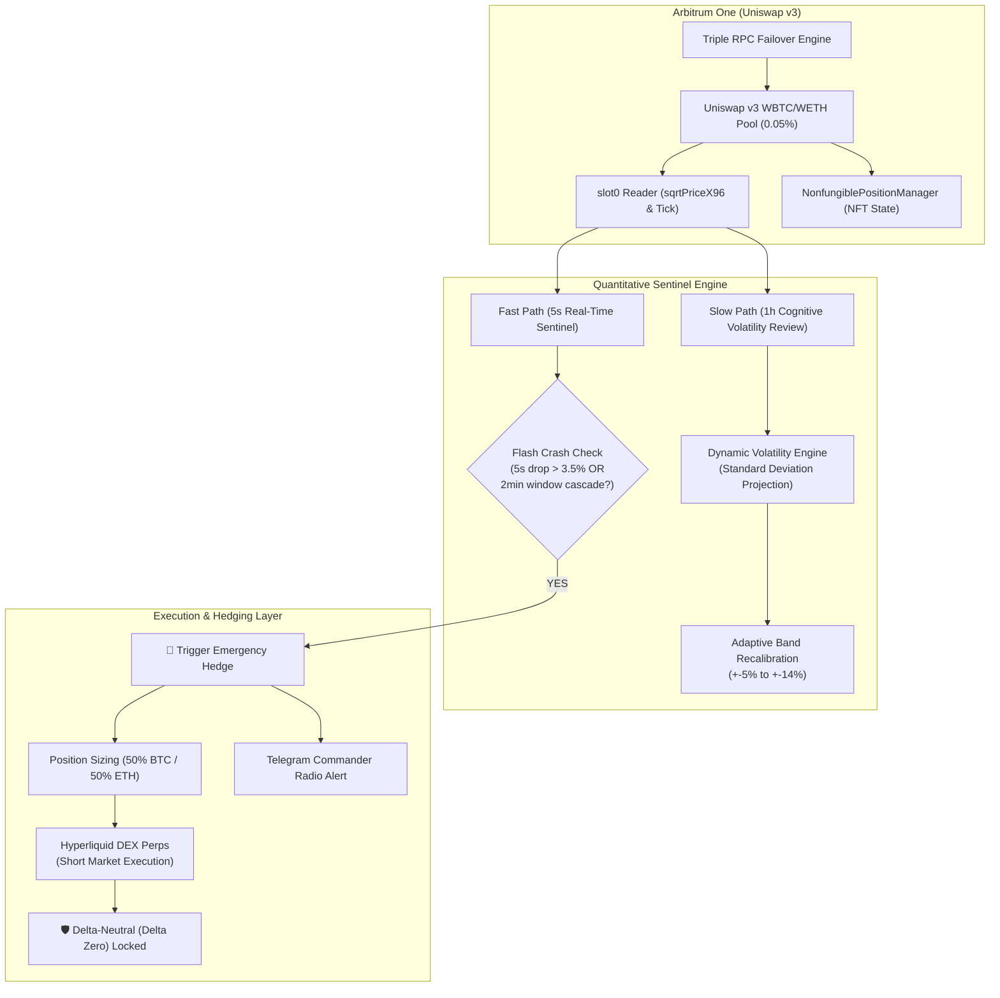

# DeFi Sentinel & Automated Liquidity Manager (ALM)
### Arbitrum Uniswap v3 Concentrated Liquidity + Cross-Protocol Hyperliquid Delta-Neutral Hedge

[](https://www.python.org/)
[](https://web3py.readthedocs.io/)
[](https://uniswap.org/)
[](https://hyperliquid.xyz/)
[]()

Autonomous quantitative system designed for **active concentrated liquidity management (ALM)** on **Uniswap v3 (Arbitrum L2)**, integrated with a **real-time sub-second crash sentinel** that automatically triggers a short hedge on **Hyperliquid Perpetuals** to establish an instant **Delta-Neutral (Delta Zero)** position during severe market downturns.

---

## 🏛️ System Architecture



---

## ⚡ Core Engineering Highlights

### 1. Resilient L2 Infrastructure (Triple RPC Failover)
* Prevents downtime caused by rate-limiting or public node hiccups.
* Implements dynamic fallback across official Arbitrum, 1RPC, and PublicNode endpoints with a 5-second aggressive timeout.

### 2. Direct On-Chain Math & Fixed-Point Conversion
* Reads `slot0` directly from the raw smart contract without third-party aggregator latency.
* Converts fixed-point `sqrtPriceX96` to human-readable ratio between WBTC (8 decimals) and WETH (18 decimals):
  $$\text{Price Ratio} = \left(\frac{\text{sqrtPriceX96}}{2^{96}}\right)^2 \times \frac{10^8}{10^{18}}$$

### 3. Dual-Loop Architecture (Fast-Path vs Slow-Path)
* **Fast-Path (Every 5 seconds):** Evaluates instantaneous price drops and sliding-window drops (24-sample `deque` spanning 120 seconds). Catches cascade liquidations before they wipe out LP capital.
* **Slow-Path (Hourly):** Calculates historical volatility over recent price samples, dynamically resizing optimal tick bands (narrow in low volatility for fee maximization, broad in high volatility for out-of-range protection).

### 4. Cross-Protocol Delta-Neutral Hedging (DEX to DEX)
* Rather than accepting impermanent loss or exiting liquidity at distressed fire-sale prices, the system hedges spot LP inventory by opening short perpetual contracts on **Hyperliquid**.
* Net portfolio exposure drops to **Delta Zero**, protecting nominal capital while retaining accumulated pool fees.

### 5. Atomic State Persistence
* Uses temporary files and `os.replace` to prevent corrupted local state files during power cuts or abrupt process termination.

---

## 🛠️ Getting Started

### Prerequisites
* Python 3.10+
* Virtual environment (`venv`)

### Installation

```bash
# 1. Clone the repository
git clone https://github.com/M3NT41H34D/defi-sentinel-alm.git
cd defi-sentinel-alm

# 2. Create and activate virtual environment
python -m venv venv
# On Windows:
venv\Scripts\activate
# On Linux/macOS:
source venv/bin/activate

# 3. Install dependencies
pip install web3 requests
```

### Configuration

Copy `.env.example` to `.env` and adjust your operational parameters:

```bash
cp .env.example .env
```

```env
# Execution mode: True for Paper Trading, False for Mainnet execution
MODO_PAPER_POOL=True

# Position targets
CAPITAL_ALOCADO_USD=1000.00
QUEDA_DISPARO_HEDGE_PCT=0.035
INTERVALO_SENTINELA_SEG=5
```

### Running the Sentinel

```bash
python pool_manager.py
```

---

## 🔒 Security & Best Practices

* **No Private Keys in Code:** All blockchain interactions and execution signatures are isolated. Private keys and wallet credentials must never be committed to source control.
* **Paper Trading by Default:** The repository ships configured in simulation mode (`MODO_PAPER_POOL=True`) to allow exhaustive observation of the dual-path sentinel before risking real capital.

---

## 👤 Author

**Douglas D’Alcântara Guanaes**  
*Backend Software & AI Engineer | Quantitative & DeFi Systems Specialist*  
* São Caetano do Sul, SP - Brazil  
* Email: douglasguanaes@gmail.com  
* GitHub: [github.com/M3NT41H34D](https://github.com/M3NT41H34D)  
* LinkedIn: [linkedin.com/in/douglasguanaes](https://www.linkedin.com/in/douglasguanaes)
